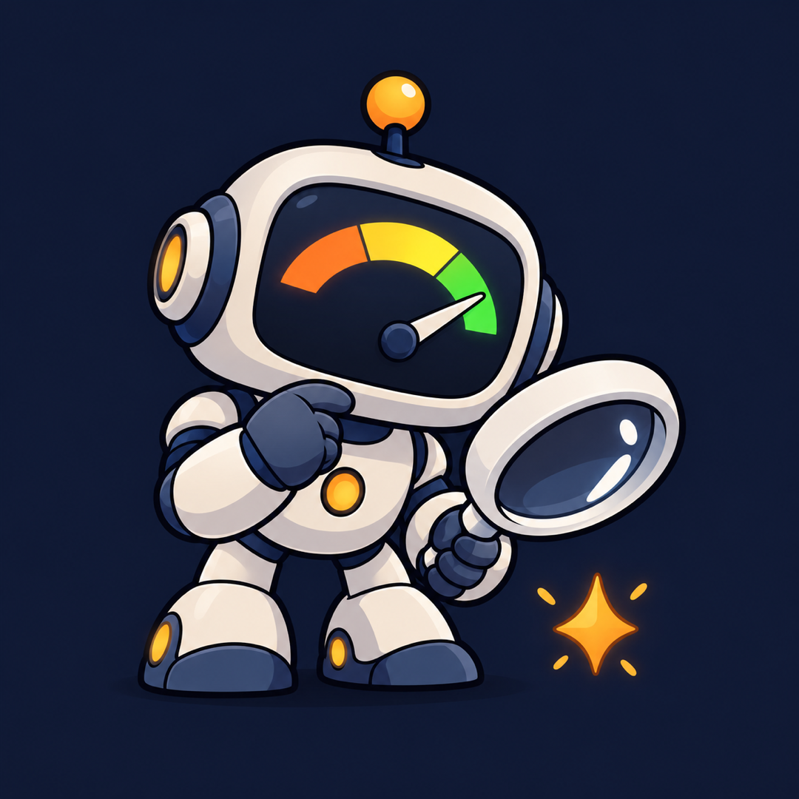
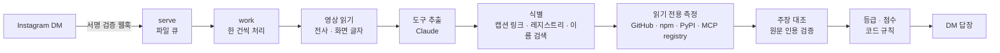

<div align="center">
  

  <h1>HyperChecker</h1>

  <p>서비스 이름은 HyperChecker, 저장소 이름은 <code>hype-checker</code>입니다.</p>

  <p><strong>"그 MCP, 진짜 쓸 만해?"</strong><br>
  인스타 릴스를 DM으로 보내면, 소개된 개발 도구를 공개 자료로 확인해 답장하는 에이전트입니다.</p>

  <p>
    <a href="https://www.instagram.com/hyper_checker/"></a>
    <a href="https://github.com/KimHands/hype-checker/actions/workflows/ci.yml"></a>
  </p>

  <p>
    <a href="#바로-써-보기">바로 써 보기</a> ·
    <a href="#평가-결과">평가 결과</a> ·
    <a href="#가드레일-설계에서-지킨-원칙">가드레일</a> ·
    <a href="PRIVACY.md">개인정보처리방침</a>
  </p>
</div>

## 바로 써 보기

설치도 가입도 필요 없습니다. 인스타그램에서 DM만 보내면 됩니다.

1. [@hyper_checker](https://www.instagram.com/hyper_checker/)를 찾습니다
2. 궁금한 개발 도구 릴스나 게시물을 DM으로 공유합니다. GitHub·npm·PyPI 링크도 됩니다
3. 받음 알림이 온 뒤 1~2분 안에 결과가 도착합니다

계정당 하루 2건까지 무료이고, 전체 하루 60건이 차면 다음 날 한국 시간 오전 9시에 다시 열립니다. 자동 확인 결과라 틀릴 수 있으니, 틀렸다면 `정정`이라고 답장해 주세요.

## 왜 만들었나

릴스에는 "이 MCP 하나면 끝", "별이 몇 만 개" 같은 소개가 넘칩니다. 확인하려면 레포를 찾고, 같은 이름의 복제본을 가려내고, README와 대조하고, 설치 스크립트까지 봐야 합니다. 이 과정을 릴스 공유 한 번으로 끝내려고 만들었습니다.

**LLM에게 "이 도구 좋아?"라고 묻지 않습니다.** 등급과 점수는 측정값으로 코드가 정하고, LLM은 원문에서 근거를 찾는 일만 맡습니다. 모르면 모른다고 답합니다.

## 캐릭터


HyperChecker는 서비스가 하는 일을 그대로 그린 로봇입니다.

- **얼굴의 게이지:** 과장(주황) → 주의(노랑) → 실체(초록). 바늘은 확인된 만큼만 움직입니다
- **돋보기:** 소개 문구가 아니라 공개 자료를 직접 들여다봅니다
- **발밑의 반짝이:** 릴스가 내세우는 화려한 약속입니다. 믿기 전에 살펴볼 대상이라 곁에 두었습니다

## 이렇게 답합니다

릴스를 보내면 받음 알림이 먼저 오고, 요약과 도구별 근거가 이어집니다. 아래는 실제 게시물을 현재 코드로 돌린 출력입니다.

```text
2. morphic — 추천 7/10 · 👍
🔗 github.com/miurla/morphic
⭐ 9,257 · 최근 30일 안에 업데이트
👍 좋은 점
 · 게시물의 '나만의 AI 검색엔진' 설명이 공식 문서와 맞아요
 · 공식 위치 하나를 찾았어요
📊 기본 5점 · 스타 규모 +1 · 업데이트 +1 → 7점
```

확정할 수 없으면 추측하지 않고, 확정이 아니라고 밝힌 후보만 보여 줍니다.

```text
1. puck — 추천 판단 보류 · ❔
🔎 이 도구일 수 있어요(확정 아님): github.com/puckeditor/puck ⭐ 13,606
⚠️ 살펴볼 점
 · 공식 위치를 하나로 정하지 못했어요
 · 측정한 코드 정보가 없어요
```

| 등급 | 뜻 |
|---|---|
| 👍 공식 설명 기준 확인됨 | 위치·측정·활동에 문제가 없고, 게시물 설명이 공식 문서와 맞음 |
| 🤔 주의해서 | 위치는 찾았지만 확인되지 않은 부분이나 경고가 있음 |
| 👎 권하지 않아요 | 공식 문서와 다른 주장, 보안 자리표시 패키지, 사칭 복제 |
| ❔ 판정 보류 | 공식 위치를 하나로 정하지 못함 |

등급은 "게시물이 얼마나 확인됐나"이고, 추천 점수(0~10)는 "도구 자체를 얼마나 권하나"입니다. 점수는 스타·업데이트·경고 신호로만 계산하고, 계산 과정을 답장에 그대로 보여 줍니다.

## 구조



| 영역 | 사용 기술 |
|---|---|
| 런타임 | Python 3.14 표준 라이브러리 중심, Docker Compose, Oracle Cloud |
| LLM | Claude Haiku 5.5 (추출, 화면 글자, 주장 대조, 같은 도구 확인) |
| 영상 | watch 스킬(yt-dlp 익명 1회, ffmpeg, Groq Whisper) |
| 측정 | GitHub API, npm, PyPI, MCP registry, deps.dev |
| 저장 | 파일 큐, SQLite 캐시(같은 게시물 7일, 같은 도구 3일) |
| 입구 | Meta Instagram API, Cloudflare Tunnel + WAF |

## 가드레일: 설계에서 지킨 원칙

LLM 출력과 게시물 입력을 신뢰하지 않는다는 전제로 둔 가드레일입니다.

**LLM의 말을 그대로 믿지 않습니다.** 주장이 공식 문서와 맞다고 하려면 Claude가 문단 번호와 원문 구절을 내야 하고, 그 구절이 실제로 그 문단에 있는지 코드가 확인합니다. 더 유명한 대안은 Claude 판단을 코드로 검증할 수 없어서 점수에 넣지 않고 소개만 합니다.

**게시물은 신뢰하지 않는 입력입니다.** 캡션, 전사, 화면 글자, README는 `<untrusted>` 블록에 데이터로만 넣습니다. 출력은 정해진 값과 원문 인용으로 제한해, 영상 속 지시문이 판정에 미치는 영향을 줄였습니다.

**판정 대상을 실행하지 않습니다.** 설치도 `npx`도 하지 않고 공개 메타데이터와 문서만 읽습니다. 서브프로세스는 허용 목록으로 제한하고, 컨테이너는 읽기 전용 루트에 권한을 모두 뺀 상태로 돌립니다.

**공개 서비스의 비용과 남용을 막습니다.** 계정당 하루 2건, 전체 60건, 추정 비용 하루 $2로 제한합니다. 항목마다 180초 마감을 두고, 일반 문자 DM에는 Claude를 쓰지 않습니다.

**개인정보를 오래 들고 있지 않습니다.** 영상과 프레임은 처리 직후 지우고, 처리 기록은 7일 뒤 삭제합니다. 외부 API에는 보낸 계정 ID를 넘기지 않습니다.

## 평가 결과

사람이 판정한 카드와 적대적 사례로 만든 정답셋 32건을 씁니다. 통과 기준은 👍 정밀도 90% 이상, 치명 오류(사람 👎 → 자동 👍) 0건, 👎 오탐 1건 이하, ❔ 비율 40% 이하입니다.

결과가 실행마다 달라져서 여러 번 돌려 비교했습니다(2026-11-03).

| | 개선 전 코드 | 현재 코드 |
|---|---|---|
| 개발셋(도구 19개) 통과 | 2회 중 2회 | 2회 중 2회 |
| 홀드아웃(도구 9개) 통과 | 3회 중 1회 | 3회 중 2회 |
| 치명 오류가 나온 홀드아웃 | 3회 중 2회 | 3회 중 1회 |

현재 코드는 5회 모두 프롬프트 인젝션 등 적대적 사례에서 등급 상한을 지켰습니다.

**이 수치의 한계:** 표본이 작고, 홀드아웃은 규칙을 고치는 동안 여러 번 봐서 독립 검증이 아닙니다. 초기 CLI의 보류 검증셋에서는 첫 실행 식별이 **9/36**으로 낮았지만, 확정한 9건은 모두 정답이었습니다. 자세한 기록은 [초기 평가 기록](docs/eval-history.md)에 있습니다.

## 실제 로그로 고친 것

공개 뒤 실제 답장을 읽어 보니, 정답셋이 잡지 못한 문제가 나왔습니다.

| 발견 | 원인 | 조치 |
|---|---|---|
| 👍가 한 번도 안 나옴. 주장 42개 중 일치 3개 | Claude가 맞다고 답한 20건 중 9건을 코드가 탈락시킴(`[3]` 표기, 마크다운 차이) | 표기를 정규화하되, 인용이 문단에 있어야 한다는 규칙은 유지 |
| 캡션에 GitHub 링크가 있는데 ❔ | 이름으로만 검색 | 게시물의 링크를 검색보다 먼저 사용 |
| TOP 10 게시물에서 찾은 도구 4개 누락 | 못 찾은 도구가 판정 자리를 차지 | 찾은 도구부터 판정하고, 빠진 도구는 이름을 표시 |
| 스타 0개와 7천 개가 똑같이 5점 | 소유자의 커밋만으로 받는 활동 가산점 | 사용자가 적으면 가산하지 않고 감점 강화 |
| NSA `ghidra`에도 스타 급증 경고 | 한 번 화제가 돼도 조작처럼 표시 | 안내만 남기고 감점과 👍 차단 제거 |

## 알려진 한계

- **README 자체의 과장은 못 잡습니다.** 👍는 "개발자의 설명과 게시물이 맞다"는 뜻입니다. 문서에는 맞게 적혀 있지만 실제 동작이 다른 경우는 외부 검증 없이는 놓칠 수 있습니다
- **기능이 실제로 되는지는 확인하지 않습니다.** 실행하지 않는 것이 원칙이기 때문입니다
- **판정 도구는 게시물당 6개까지입니다.** 비용 때문이며, 빠진 도구는 이름을 알려 줍니다
- **한 번에 한 건씩 처리합니다.** 건당 약 1분이라 몰리면 받음 알림과 결과가 함께 늦어집니다
- **자동 결과는 틀릴 수 있습니다.** 그래서 답장마다 고지하고 `정정` 경로를 둡니다

## 직접 실행

읽기 전용 CLI로 게시물 하나를 확인할 수 있습니다. `gh` 로그인과 watch 스킬이 필요하고, 도구 추출에는 LM Studio(`localhost:1234`) 또는 Claude를 씁니다.

```bash
python3 -m venv .venv && .venv/bin/pip install -r requirements-dev.txt
.venv/bin/python -m hype_checker check <URL·mp4·캡션 텍스트>     # → out/<id>/bundle.md
.venv/bin/python -m unittest discover -s tests
```

서버 배포는 [`deploy/README.md`](deploy/README.md), 설계 과정은 [`docs/design-v1.md`](docs/design-v1.md)부터 [`v2`](docs/design-v2.md), [`v3`](docs/design-v3.md), [`v4`](docs/design-v4.md)까지 있습니다.

## 공개본에 대해

이 저장소는 비공개 개발 저장소에서 운영 메모와 계정 정보를 뺀 공개본입니다. 이력을 스냅샷으로 정리해 올리기 때문에 커밋 수가 실제 개발 이력보다 적습니다. 정답셋의 판정 사유 글도 생략했습니다.
